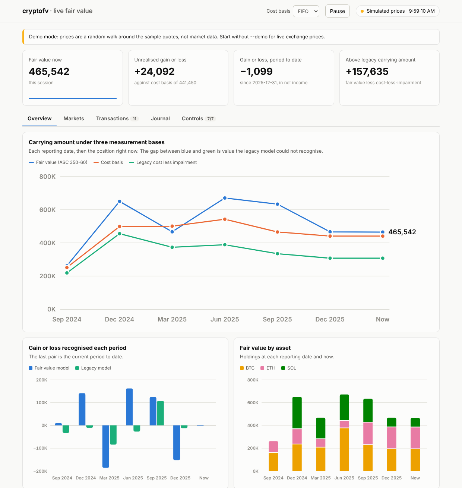
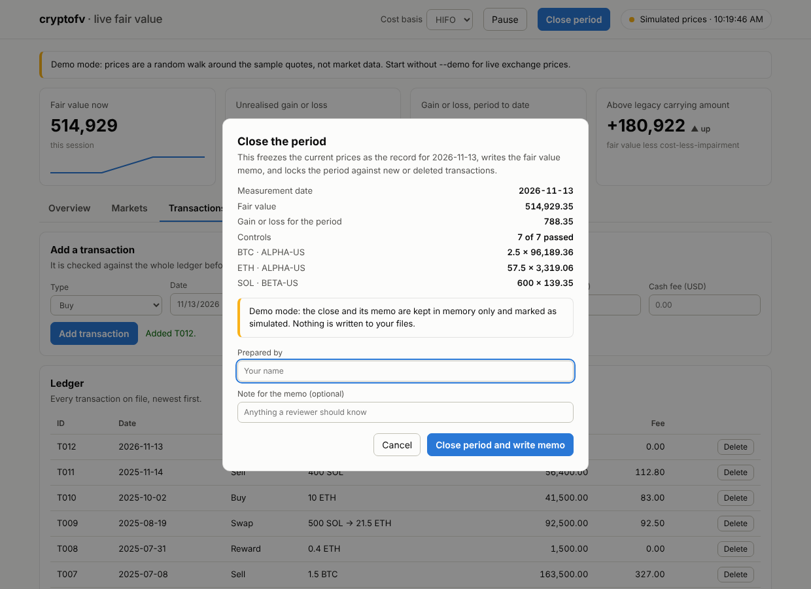

# cryptofv

Fair value accounting for crypto assets under US GAAP (ASC 350-60 and ASC 820), from raw transactions to an audit-ready disclosure pack. Pure Python, no runtime dependencies.



It runs two ways:

- **`cryptofv serve`** opens a local web app that marks your holdings to market at current exchange prices, re-selects the principal market on every update, and lets you add transactions from the browser.
- **`cryptofv run`** produces the period-end disclosure pack as files.

Both use the same engine, so the live view is a flash close of the current period, not a separate calculation. When the numbers are final, **Close period** turns the live view into a record: it freezes the price evidence, writes the fair value memo, and locks the period.

Give it a transaction history and market quotes, and it returns:

- the **principal market** and price for each asset at each reporting date, with a written rationale
- balanced **journal entries** for purchases, sales, swaps, rewards and period-end remeasurement
- the two required disclosures: **significant holdings** and the **period rollforward**
- a side-by-side run of the **legacy cost-less-impairment model**, period by period
- the **transition adjustment** to opening retained earnings for any adoption date
- **sensitivity analysis**: price shocks, and how far the measurement moves with the choice of market
- seven **reconciliation controls** that prove the numbers tie
- an **HTML dashboard**, a Markdown report and CSVs of everything

## Why

ASU 2023-08 (codified as ASC 350-60) moved in-scope crypto assets from the cost-less-impairment model to fair value through net income, for fiscal years beginning after December 15, 2024. Three things make it harder than it sounds:

1. The price must come from the right market. ASC 820 points to the principal market the entity can access, which is often not the one with the best price or the deepest global volume.
2. Cost basis still has to be tracked lot by lot, because the disclosures need it even though the balance sheet no longer does.
3. Adoption needs the old model too. The transition adjustment is fair value less the legacy carrying amount, and the legacy carrying amount depends on every price low since each lot was bought.

`cryptofv` handles all three and checks its own arithmetic.

## Quick start

```bash
git clone https://github.com/theabdulaziz/cryptofv.git
cd cryptofv
pip install -e ".[dev]"

# Live web app with simulated prices (works offline)
cryptofv serve --demo \
  --transactions examples/transactions.csv \
  --quotes examples/quotes.csv \
  --price-lows examples/price_lows.csv

# Period-end disclosure pack as files
cryptofv run \
  --transactions examples/transactions.csv \
  --quotes examples/quotes.csv \
  --price-lows examples/price_lows.csv \
  --adoption-date 2025-01-01 \
  --out out

open out/dashboard.html   # or just double-click it
pytest
```


A generated copy of every output is in [`examples/output`](examples/output). The example data is synthetic: markets, prices and volumes are invented for illustration and are not real market data.

## Live web app

```bash
cryptofv serve --transactions my_transactions.csv                 # live prices
cryptofv serve --transactions my_transactions.csv --quotes history.csv --price-lows lows.csv
cryptofv serve --demo --transactions examples/transactions.csv --quotes examples/quotes.csv
```

It opens `http://127.0.0.1:8765` in your browser. The transactions file is created if it does not exist, so you can start from an empty ledger and enter everything in the app.

**How "real time" works.** Today is treated as a provisional reporting date. Each date in `--quotes` is a closed prior period; today's quotes come from the price feed. Every refresh re-runs the whole engine, so the page always shows what the books would say if the period closed this minute.

| Tab | What it shows |
|---|---|
| Overview | Fair value now, period-to-date gain or loss, the three measurement bases over time, holdings at live prices, the period-to-date rollforward, price sensitivity |
| Markets | Every exchange's price and 24-hour volume per asset, which one is the principal market and why, and what the holding would be worth in each |
| Transactions | Add a buy, sell, swap or reward. It is validated against the whole ledger before it is saved. Delete with a two-step confirm |
| Journal | Every journal entry including the provisional remeasurement, with a filter, CSV exports and a printable report |
| Controls | The seven reconciliation controls re-run on every update, open lots, closed periods with their integrity status and memos, and the comparison with the legacy model |

The cost basis method can be switched in the header to see FIFO, LIFO and highest-cost-first side by side on the same ledger.

### One-click period close



A live monitor shows a number that is gone a second later. Closing makes it a record, in one step:

1. **Freezes the evidence.** The price snapshot behind the measurement is saved as that period's quotes: every market observed, including the ones not selected and the ones not accessible.
2. **Writes the fair value memo.** A printable page with the measurement, the principal-market determination and rationale for each asset, how far the figure would move under another accessible market, the rollforward, the closing entries, the control results, the judgments a reviewer should challenge, and sign-off lines.
3. **Locks the period.** Transactions dated on or before the close can no longer be added or deleted in the app. Corrections go in the current period.
4. **Fingerprints it.** A SHA-256 hash of the frozen quotes and every transaction up to the close date is recorded. It is recomputed on every update, and the period is flagged as altered if someone later edits the files by hand.

A close is refused while any control fails or any holding lacks a current price. Records are written to a `closes/` folder beside the transactions file. In `--demo` mode the close is kept in memory only and the memo is stamped as simulated, so made-up prices can never end up in real records.

**Price feed.** Live mode polls the public REST tickers of Coinbase Exchange, Kraken and Bitstamp (no API key), converts 24-hour volume to USD so markets are compared on one measure, and caches for 10 seconds. If an asset has no live price the app falls back to its last recorded close and says so. `--exchanges` chooses which to poll; `--inaccessible kraken` keeps an exchange on screen but excludes it from the principal-market decision. `--demo` replaces the feed with a seeded random walk and labels the page as simulated.

| Flag | Meaning |
|---|---|
| `--demo` | Simulated prices around `--quotes`. No network needed. |
| `--exchanges coinbase,kraken` | Exchanges to poll. |
| `--inaccessible bitstamp` | Quote but treat as a market the entity cannot access. |
| `--refresh 15` | Seconds between updates. Default 15 live, 3 demo. |
| `--port 8765`, `--host`, `--no-browser` | Server options. |

**Security.** The server is a single-user tool. It binds to `127.0.0.1`, has no login, and refuses writes from other origins and requests for other hostnames. Do not expose it to a network.

### What the sample shows

| Period end | Fair value | Legacy carrying | Cumulative difference | Fair value gain/(loss) | Legacy gain/(loss) |
|---|---:|---:|---:|---:|---:|
| 2024-12-31 | 650,650.00 | 456,000.00 | 194,650.00 | 140,900.00 | (10,500.00) |
| 2025-03-31 | 467,014.44 | 373,956.00 | 93,058.44 | (185,585.56) | (83,994.00) |
| 2025-06-30 | 671,099.28 | 389,196.00 | 281,903.28 | 162,084.84 | (26,760.00) |

In the fourth quarter of 2024 the portfolio rose by 140,900 and the legacy model reported a loss, because it books declines and never recoveries. That asymmetry is what the new standard removed. The 194,650 at year end is the pre-tax adjustment to opening retained earnings for an entity adopting on January 1, 2025.

### Options

| Flag | Meaning |
|---|---|
| `--method fifo\|lifo\|hifo` | Order in which lots are relieved on disposal. Default `fifo`. |
| `--capitalize-fees` | Add purchase fees to cost basis. Default is to expense them. |
| `--price-lows FILE` | Price history for the legacy impairment comparison. |
| `--adoption-date 2025-01-01` | Report the transition adjustment for adoption on this date. |
| `--period-ends 2025-03-31,2025-06-30` | Reporting dates. Default is every date in the quotes file. |

The command exits with status 2 if any control fails, so it can gate a close process or a CI job.

### As a library

```python
from cryptofv import FairValueEngine, analytics
from cryptofv.io import load_transactions, load_quotes

quotes = load_quotes("examples/quotes.csv")
result = FairValueEngine(cost_method="fifo").run(
    load_transactions("examples/transactions.csv"),
    quotes,
    period_ends=sorted({q.date for q in quotes}),
)
assert result.controls_passed
for row in analytics.compare_models(result):
    print(row.period_end, row.fair_value, row.legacy_carrying)
```

## Input files

**Transactions**: `tx_id, date, asset, type, units, amount, fee, to_asset, to_units`

| `type` | Meaning | `amount` is |
|---|---|---|
| `buy` | Acquire for cash | gross cash paid, before fees |
| `sell` | Dispose for cash | gross cash received, before fees |
| `swap` | Exchange `units` of `asset` for `to_units` of `to_asset` | fair value of the exchange |
| `reward` | Staking reward, airdrop or mining receipt | fair value of the units received |

**Quotes**: `date, asset, market, price, volume, accessible, fee_bps`. One row per asset per market per reporting date. `accessible` records whether the entity can transact in that market at the measurement date.

**Price lows** (optional): `date, asset, low`. The lowest price observed up to each date since the previous row. Daily rows give exact legacy impairment. Sparser rows work but can impair a lot for a low that came before it was bought within the same interval.

## How the accounting works

### Which price (ASC 820)

1. Markets the entity cannot access are excluded, whatever their volume.
2. Among the rest, the **principal market** is the one with the greatest volume. Its quoted price is the fair value.
3. If no accessible market has volume data, the engine falls back to the **most advantageous market**: the highest price net of transaction costs. Costs decide which market is chosen, but the fair value is still the unadjusted quoted price.

The dashboard's market selection table shows what each holding would be worth in every quoted market, so the effect of this judgment is visible. In the sample data the offshore venue has the deepest volume but is inaccessible, and the principal market for SOL moves from one exchange to another in the second quarter of 2025.

### Which entries

| Event | Entry |
|---|---|
| Purchase | Dr Crypto assets (cost), Dr Fee expense, Cr Cash |
| Reward | Dr Crypto assets, Cr Crypto rewards income, at fair value on receipt |
| Period end | Remeasure each lot to units × principal-market price, against Gain or Loss in net income |
| Sale | Dr Cash, Cr Crypto assets (carrying amount of the lots relieved), difference to Gain or Loss |
| Swap | Dr Crypto assets (asset received, at fair value), Cr Crypto assets (asset given, at carrying amount), difference to Gain or Loss |

### Three measurement bases per lot

| Basis | Used for |
|---|---|
| **Cost** | Never remeasured. Cost basis disclosure and realised gain or loss. |
| **Fair value** | The ASC 350-60 carrying amount in the ledger. |
| **Legacy carrying amount** | Cost less impairment under ASC 350-30: written down to the lowest price observed while held, never written back up. |

Keeping all three on every lot is what makes the model comparison and the transition adjustment a lookup instead of a separate project.

### Controls

Every run re-derives the key numbers two independent ways:

1. Every journal entry balances.
2. The general ledger balance of each crypto asset equals the sum of its open lots.
3. Opening + additions − dispositions + gains − losses = closing, for every asset in every period.
4. Gain and loss accounts equal the rollforward's gains and losses.
5. Units acquired less units disposed, traced from the raw transactions, equal units held.
6. Cumulative gain equals realised plus unrealised.
7. Legacy carrying amount never exceeds cost.

The test suite (67 tests) covers each accounting rule on small hand-checkable cases, runs the full sample under all three cost methods, and exercises the price feeds, the live session, period close with tamper detection, and the HTTP server.

## Project layout

```
src/cryptofv/
  principal_market.py   ASC 820 market selection
  engine.py             lot ledger, journal entries, legacy shadow model
  controls.py           reconciliation controls
  analytics.py          model comparison, transition, sensitivity, trial balance
  report.py             Markdown disclosure report
  html_report.py        self-contained dashboard with inline SVG charts
  feeds.py              live exchange feed and simulated feed
  live.py               live session: today as a provisional reporting date
  close.py              period close: evidence fingerprint and fair value memo
  server.py             local HTTP server and JSON API (standard library)
  web/index.html        the web app, one file, no build step
  io.py, cli.py         CSV handling and the command line
```

## Scope and limitations

- The period lock and fingerprint detect changes; they do not prevent someone with file access from making them. This is evidence of integrity, not access control.
- The live feed is a last-trade snapshot polled every few seconds. It is a monitoring and flash-close tool; a period-end measurement should use the price at the entity's documented cut-off time.
- USD spot pairs only. An asset with no USD market on the chosen exchanges has no live price.
- Cash fees only. Fees paid in crypto (gas) and transfers between an entity's own wallets are not modelled.
- Assumes every asset passed in is within the scope of ASC 350-60. The scope test (fungible, no enforceable rights to underlying goods, not issued by the reporting entity, and so on) is a judgment made before using this tool. Wrapped tokens and most NFTs are outside it.
- "Volume" stands in for "volume and level of activity". A real principal-market assessment may weigh other evidence.
- Reward income is recognised at fair value on receipt. Whether and when a reward is earned is a revenue recognition question this tool does not answer.
- Amounts are pre-tax. No deferred tax, tax lots or wash-sale logic.
- Single reporting currency.

This is an educational and research tool. It is not accounting advice and is not a substitute for the Codification or for professional judgment.

## License

MIT
